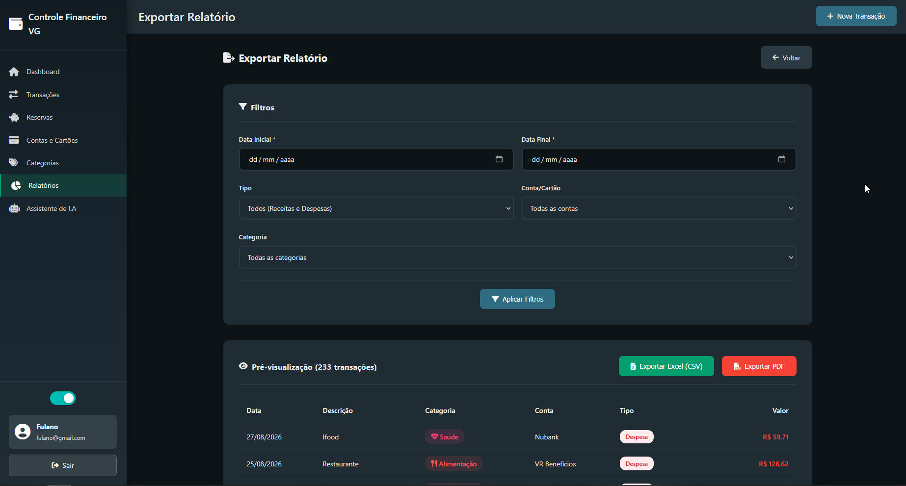
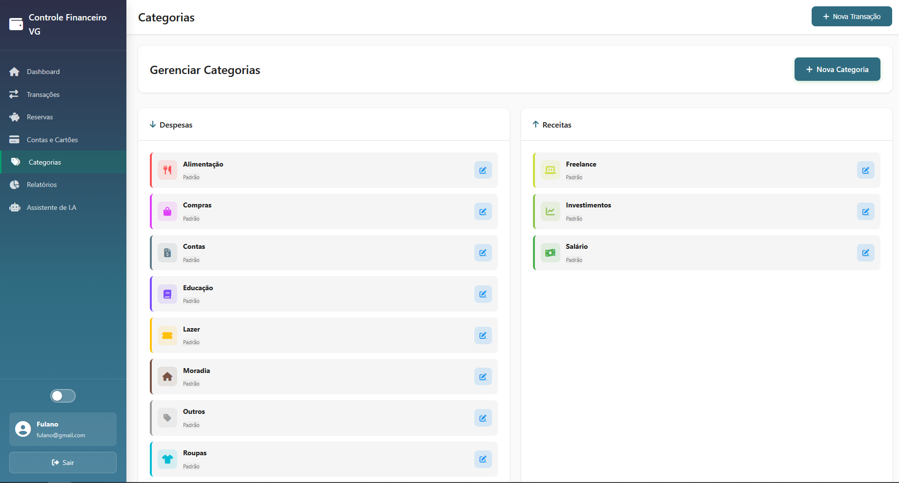
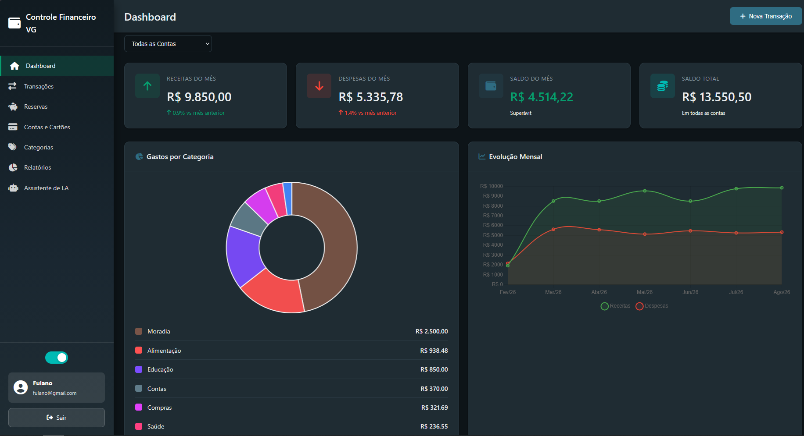
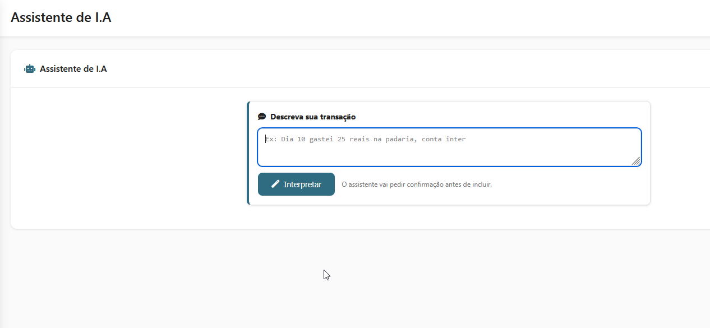

# Controle Financeiro Pessoal com IA

Aplicação web em PHP para organizar contas, transações, reservas financeiras e relatórios, com um assistente para acelerar o registro de movimentações.


## Problema e solução

Registrar cada movimentação manualmente costuma tornar o controle financeiro cansativo. Este projeto reúne as rotinas essenciais de finanças pessoais em uma interface responsiva e adiciona um assistente capaz de interpretar uma descrição e preparar os campos da transação.

## Funcionalidades

- Cadastro, login, recuperação de senha e controle de sessão.
- Contas bancárias, dinheiro e cartões.
- Categorias personalizadas para receitas e despesas.
- Transações parceladas, recorrentes e com status de pagamento.
- Reservas e metas com acompanhamento de progresso.
- Dashboard com resumo mensal e gráficos.
- Relatórios filtrados com exportação.
- Assistente para preenchimento rápido de movimentações.

## Arquitetura

O backend segue MVC, separando controllers, models e views. A persistência usa PDO e prepared statements; senhas são processadas com `password_hash`. O frontend é construído com HTML, CSS e JavaScript, sem dependência de um framework de interface.

## Stack

| Camada | Tecnologias |
| --- | --- |
| Backend | PHP 8+, MVC |
| Banco de dados | MySQL, PDO |
| Frontend | HTML5, CSS3, JavaScript |
| Visualização | Chart.js, Font Awesome |
| Deploy | Procfile, Nixpacks |

## Telas

<p>
  
  
</p>
<p>
  
  
</p>

## Executando localmente

1. Crie um banco MySQL e importe `database.sql`.
2. Copie as configurações de exemplo e informe as credenciais do banco.
3. Aponte o servidor web para a pasta `public/`.

Exemplo com o servidor embutido do PHP:

```bash
php -S localhost:8000 -t public public/router.php
```

Acesse `http://localhost:8000`.

## Status

Projeto de estudo funcional, com foco em arquitetura MVC, segurança de entrada e experiência de gestão financeira.

## Autor

Desenvolvido por [Vitor Goetmann](https://github.com/vitorgoetmann).
